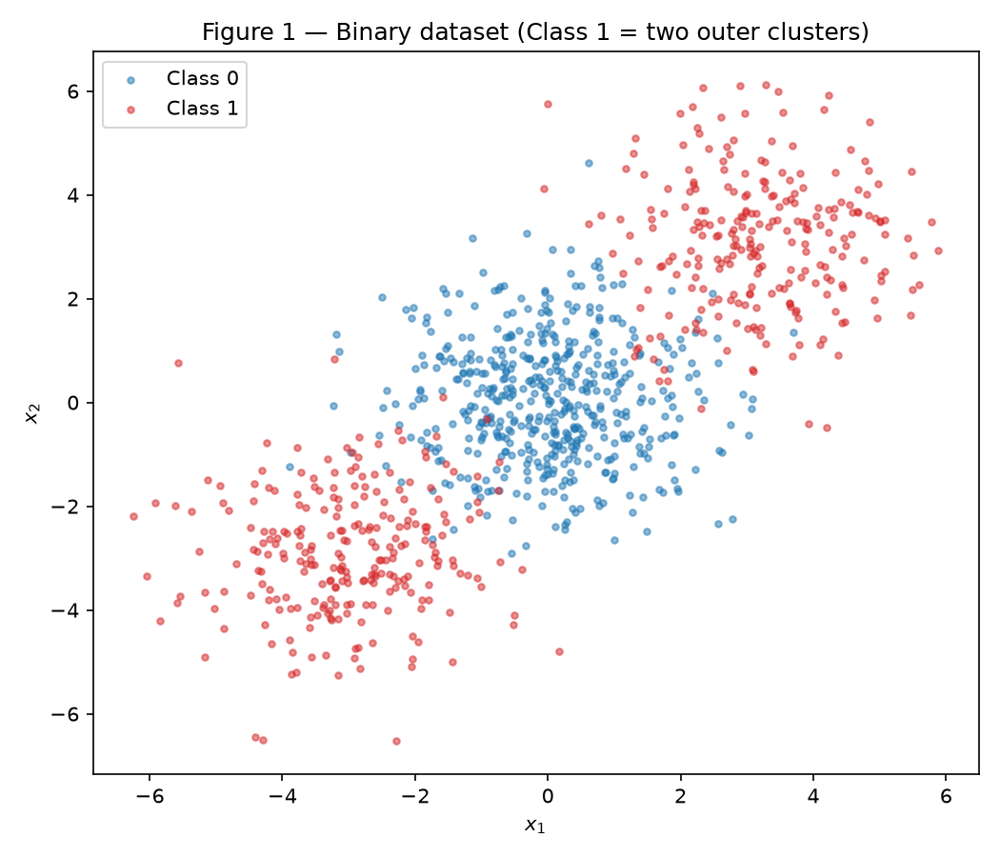
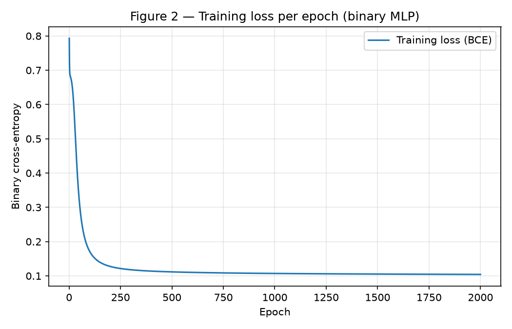
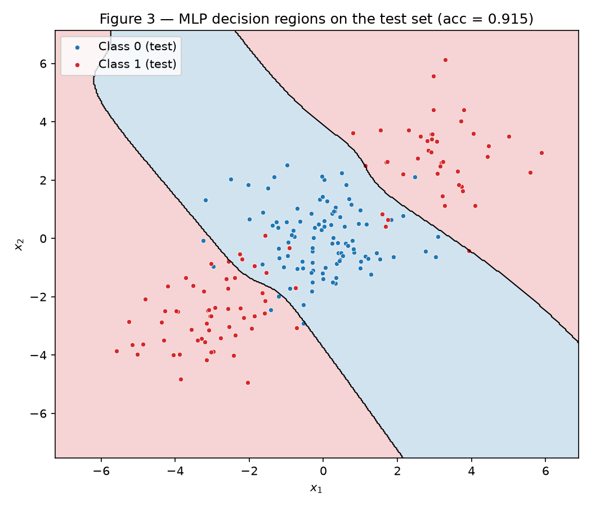
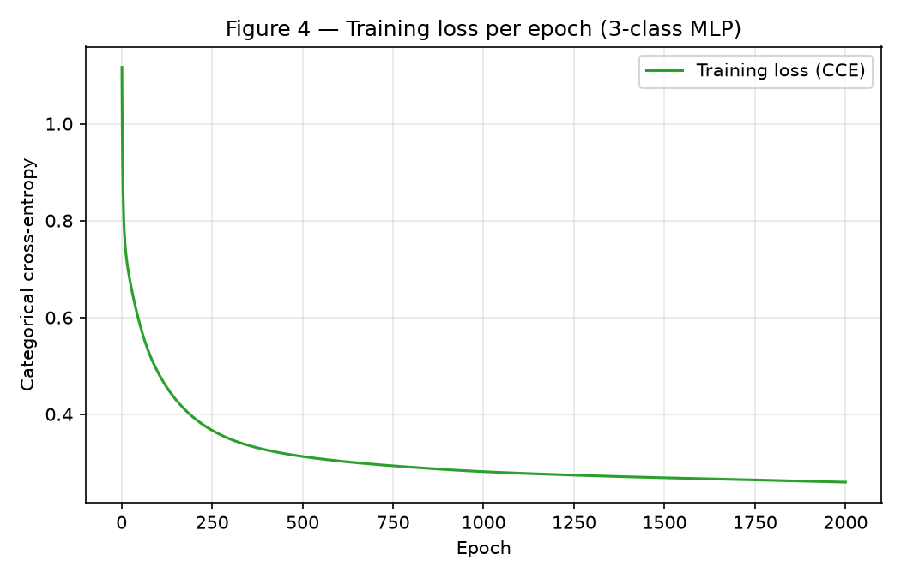
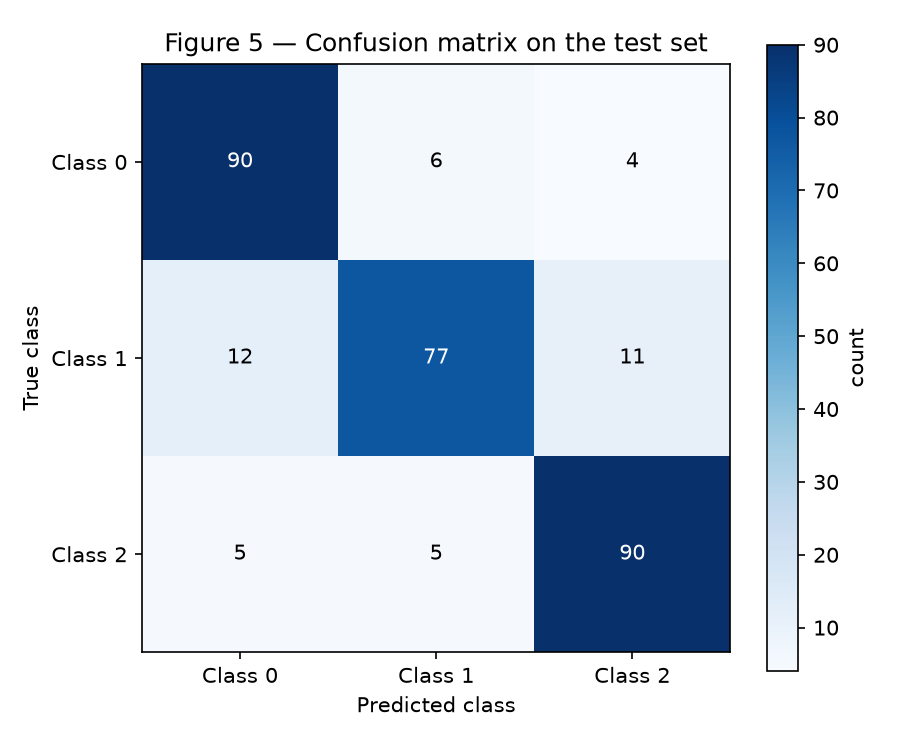
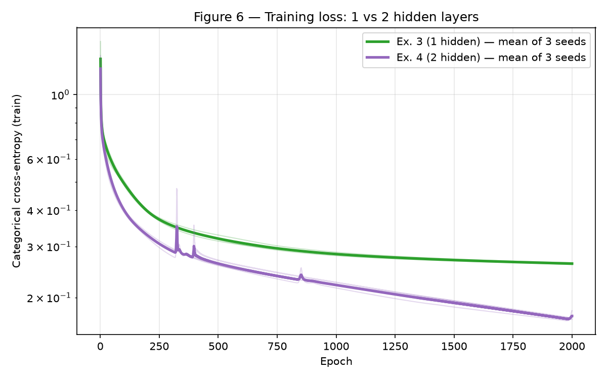

# MLP — Understanding Multi-Layer Perceptrons

**Approach.** Exercise 1 is one step of backpropagation worked by hand. For
Exercises 2–4 I wrote a single MLP class from scratch in `mlp.py` (NumPy only). The
layer sizes, the output activation (sigmoid or softmax) and the matching loss
(binary or categorical cross-entropy) are constructor arguments. The forward pass,
the backward pass and the update step are the same code for the binary problem
(Exercise 2), the 3-class problem (Exercise 3) and the deeper network (Exercise 4).

Technical rules used throughout: a single fixed generator
`rng = np.random.default_rng(42)`; every plot has a title, axis labels and a
legend; `scikit-learn` is used only for `make_blobs`, `make_classification`,
`train_test_split`, the confusion matrix and the logistic-regression baselines.
Activations, losses, gradients and updates are my own code.

## Exercise 1 — One Step of Backpropagation, by Hand

Network: 2 inputs, 2 hidden \(\tanh\) units, 1 \(\tanh\) output, loss
\(L = (y-\hat{y})^2\). Values: \(\mathbf{x} = [0.5, -0.2]\), \(y = 1\),
\(\eta = 0.3\), and

$$
\mathbf{W}^{(1)} = \begin{bmatrix} 0.3 & -0.1 \\ 0.2 & 0.4 \end{bmatrix}, \quad
\mathbf{b}^{(1)} = [0.1,\ -0.2], \quad
\mathbf{W}^{(2)} = [0.5,\ -0.3], \quad
b^{(2)} = 0.2
$$

### A — Forward pass

**1. Hidden pre-activations.**

$$
\begin{aligned}
z^{(1)}_1 &= 0.3(0.5) + (-0.1)(-0.2) + 0.1 = 0.15 + 0.02 + 0.1 = 0.2700 \\
z^{(1)}_2 &= 0.2(0.5) + 0.4(-0.2) - 0.2 = 0.10 - 0.08 - 0.2 = -0.1800
\end{aligned}
$$

**2. Hidden activations.**

$$
\mathbf{h}^{(1)} = \tanh(\mathbf{z}^{(1)}) = [\tanh(0.27),\ \tanh(-0.18)] = [0.263625,\ -0.178081]
$$

**3. Output pre-activation.**

$$
u^{(2)} = 0.5(0.263625) + (-0.3)(-0.178081) + 0.2 = 0.131812 + 0.053424 + 0.2 = 0.385237
$$

**4. Output and loss.**

$$
\hat{y} = \tanh(0.385237) = 0.367247, \qquad
L = (1 - 0.367247)^2 = (0.632753)^2 = 0.400377
$$

### B — Backward pass

**Start.** Differentiating the loss with respect to the output:

$$
\frac{\partial L}{\partial \hat{y}} = -2(y - \hat{y}) = -2(0.632753) = -1.265507
$$

**1. Through the output \(\tanh\).** Using \(\tanh'(u) = 1 - \tanh^2(u) = 1 - \hat{y}^2\):

$$
1 - \hat{y}^2 = 1 - 0.367247^2 = 0.865130, \qquad
\frac{\partial L}{\partial u^{(2)}} = -1.265507 \times 0.865130 = -1.094828
$$

**2. Output layer.** Because \(u^{(2)} = \mathbf{W}^{(2)} \mathbf{h}^{(1)} + b^{(2)}\), the derivative of \(u^{(2)}\) with respect to each weight is the matching hidden activation, and with respect to the bias it is 1:

$$
\begin{aligned}
\frac{\partial L}{\partial \mathbf{W}^{(2)}} &= \frac{\partial L}{\partial u^{(2)}}\, \mathbf{h}^{(1)}
= -1.094828 \times [0.263625,\ -0.178081] = [-0.288624,\ 0.194968] \\
\frac{\partial L}{\partial b^{(2)}} &= \frac{\partial L}{\partial u^{(2)}} = -1.094828
\end{aligned}
$$

**3. Propagate back.** The derivative of \(u^{(2)}\) with respect to \(\mathbf{h}^{(1)}\) is \(\mathbf{W}^{(2)}\). The derivative of \(\mathbf{h}^{(1)}\) with respect to \(\mathbf{z}^{(1)}\) is \(1 - (\mathbf{h}^{(1)})^2\), applied element-wise:

$$
\begin{aligned}
\frac{\partial L}{\partial \mathbf{h}^{(1)}} &= \frac{\partial L}{\partial u^{(2)}}\, \mathbf{W}^{(2)}
= -1.094828 \times [0.5,\ -0.3] = [-0.547414,\ 0.328448] \\
1 - (\mathbf{h}^{(1)})^2 &= [1 - 0.263625^2,\ 1 - 0.178081^2] = [0.930502,\ 0.968287] \\
\frac{\partial L}{\partial \mathbf{z}^{(1)}} &= [-0.547414 \times 0.930502,\ 0.328448 \times 0.968287] = [-0.509370,\ 0.318032]
\end{aligned}
$$

**4. Hidden layer.** Because \(\mathbf{z}^{(1)} = \mathbf{W}^{(1)} \mathbf{x} + \mathbf{b}^{(1)}\), the weight gradient is the outer product of the hidden gradient with the input, and the bias gradient equals the hidden gradient:

$$
\frac{\partial L}{\partial \mathbf{W}^{(1)}} = \frac{\partial L}{\partial \mathbf{z}^{(1)}}\, \mathbf{x}^{\top}
= \begin{bmatrix} -0.509370 \times 0.5 & -0.509370 \times (-0.2) \\ 0.318032 \times 0.5 & 0.318032 \times (-0.2) \end{bmatrix}
= \begin{bmatrix} -0.254685 & 0.101874 \\ 0.159016 & -0.063606 \end{bmatrix}
$$

$$
\frac{\partial L}{\partial \mathbf{b}^{(1)}} = \frac{\partial L}{\partial \mathbf{z}^{(1)}} = [-0.509370,\ 0.318032]
$$

### C — Parameter update

Each parameter moves by \(-\eta\) times its gradient, with \(\eta = 0.3\):

$$
\begin{aligned}
\mathbf{W}^{(2)} &\leftarrow [0.5 - 0.3(-0.288624),\ -0.3 - 0.3(0.194968)] = [0.586587,\ -0.358490] \\
b^{(2)} &\leftarrow 0.2 - 0.3(-1.094828) = 0.528448 \\
\mathbf{W}^{(1)} &\leftarrow \begin{bmatrix} 0.3 - 0.3(-0.254685) & -0.1 - 0.3(0.101874) \\ 0.2 - 0.3(0.159016) & 0.4 - 0.3(-0.063606) \end{bmatrix}
= \begin{bmatrix} 0.376405 & -0.130562 \\ 0.152295 & 0.419082 \end{bmatrix} \\
\mathbf{b}^{(1)} &\leftarrow [0.1 - 0.3(-0.509370),\ -0.2 - 0.3(0.318032)] = [0.252811,\ -0.295410]
\end{aligned}
$$

**Would the loss go up or down on a second forward pass? Down.** Gradient descent
moves every parameter against its gradient, which is the direction of steepest
local decrease of \(L\). With a step this size the decrease is real, not just in
theory. Rerunning the forward pass with the updated parameters gives
\(\hat{y} = 0.711181\) and \(L = 0.083417\), against \(L = 0.400377\) before the
update. The output moved from 0.367 toward the target 1.0. The biggest changes are
in \(b^{(2)}\) and \(\mathbf{W}^{(2)}\), which sit closest to the loss and have the
largest gradients.

The notebook [`code/ex1_backprop.ipynb`](code/ex1_backprop.ipynb) repeats these
calculations in NumPy as a check, and every number above matches.

## Exercise 2 — Binary Classification

### A — Generate the data

The data is generated exactly as specified: `make_blobs` with centers
\((0,0)\), \((3,3)\) and \((-3,-3)\), 500/250/250 points, `cluster_std=1.2`,
`random_state=42`, and `y = (c > 0)`. Class 0 is the central cluster; Class 1 is
split into the two outer clusters on either side of it. The split is 80/20
(`test_size=0.2, random_state=42, stratify=y`), giving 800 training points and
200 test points.

```python
rng = np.random.default_rng(42)  # the single generator used for the MLP weights

# Three blobs along the diagonal: (0,0) is class 0, (3,3) and (-3,-3) are class 1.
centers = np.array([[0., 0.], [3., 3.], [-3., -3.]])
X, c = make_blobs(n_samples=[500, 250, 250], centers=centers,
                  cluster_std=1.2, random_state=42)
y = (c > 0).astype(int)      # class 0: 1 cluster | class 1: 2 clusters

# Stratified 80/20 split keeps the 50/50 class balance in both halves.
X_train, X_test, y_train, y_test = train_test_split(
    X, y, test_size=0.2, random_state=42, stratify=y)
```


/// caption
Figure 1 — The 1000 points colored by class. Class 1 (red) sits on both sides of
Class 0 (blue) along the diagonal.
///

### B — Establish the baseline

`LogisticRegression` fitted on the training set reaches a **test accuracy of
0.4750**. That is worse than always predicting Class 0, which would get 0.50.

### C — Implement the MLP

The class below is the whole model and is reused unchanged in Exercises 3 and 4:

- **Layers:** `layer_sizes` is a list such as `[2, 8, 1]`, so any depth works.
  Weights are drawn from \(\mathcal{N}(0, 1/n_{\text{in}})\) using the shared
  `rng`, and biases start at zero.
- **Forward pass:** \(\tanh\) on every hidden layer; sigmoid (binary) or softmax
  (multi-class) at the output.
- **Loss:** binary cross-entropy (Exercise 2) or categorical cross-entropy
  (Exercise 3).
- **Backward pass:** the output error is `(P - Y) / N`. Each layer's weight
  gradient is `A[l].T @ delta` and its bias gradient is the column sum of
  `delta`. The error is sent back with `delta @ W[l].T`, multiplied by the
  \(\tanh\) derivative `1 - A[l]**2`.
- **Update:** full-batch gradient descent, \(\theta \leftarrow \theta - \eta\, \nabla_\theta L\).

I checked the analytic gradients against finite differences for both output types,
and they agree.

```python
--8<-- "docs/exercises/mlp/code/mlp.py"
```

**Training.** Architecture **`[2, 8, 1]`** (2 inputs, one hidden layer of 8 tanh
units, 1 sigmoid output; 33 parameters), learning rate **\(\eta = 0.5\)**,
**2000 epochs** of full-batch gradient descent. The final training loss is
**0.1043**, the training accuracy is **0.9675**, and the **test accuracy is
0.9150**.


/// caption
Figure 2 — Binary cross-entropy on the training set at each epoch. It falls
quickly in the first few hundred epochs and then levels off near 0.10.
///


/// caption
Figure 3 — The network's prediction on a grid, with the test points on top. Blue
is the Class 0 region and red is the Class 1 region. The Class 0 region is a
diagonal band through the middle; Class 1 gets both corners outside it.
///

### D — Analysis

A logistic regression draws **one straight line** and labels one side Class 0 and
the other side Class 1. Figure 3 shows the region Class 1 actually needs. It is
**two separate pieces**: the bottom-left corner around \((-3,-3)\) and the
top-right corner around \((3,3)\), with the Class 0 band running between them.
Any straight line gives Class 1 a single half-plane, so it can contain at most one
of the two corners. The other corner has to share a side with Class 0.

The best a straight line can do, then, is find Class 0 plus roughly one of the
outer clusters. Because Class 0 sits in the middle and the two Class 1 clusters
are symmetric about it, the log-loss gains from leaning toward either corner cancel
out. Logistic regression settles on a nearly useless line that mixes the classes on
both sides, and it scores 47.5%, worse than a constant guess.

The hidden layer fixes this. Each of the 8 tanh units makes its own soft line, and
the output unit combines them. Two roughly parallel lines, one on each side of the
center, are enough to carve out the band in Figure 3: inside both lines means
Class 0, and outside either line means Class 1. That non-convex, two-piece
Class 1 region is something no single line can make. The remaining errors
(test 91.5%) are points in the overlap where the clusters touch, since
`cluster_std = 1.2` makes some outer points fall inside the band.

## Exercise 3 — Multi-Class Classification

### A — Generate the data

`make_classification(n_samples=1500, n_features=4, n_informative=4,
n_redundant=0, n_repeated=0, n_classes=3, n_clusters_per_class=2,
class_sep=1.0, random_state=42)`, then an 80/20 split with `random_state=42` and
`stratify=y`. That gives 1200 training points and 300 test points (100 per class),
each with 4 features.

```python
rng = np.random.default_rng(42)  # the single generator used for the MLP weights

# 3 classes x 2 clusters = 6 Gaussian clusters, all 4 features informative.
X, y = make_classification(n_samples=1500, n_features=4, n_informative=4,
                           n_redundant=0, n_repeated=0, n_classes=3,
                           n_clusters_per_class=2, class_sep=1.0,
                           random_state=42)

# Same seed and stratification as Exercise 2: 100 test points per class.
X_train, X_test, y_train, y_test = train_test_split(
    X, y, test_size=0.2, random_state=42, stratify=y)
```

### B — Adapt the network

Only two things change, and both are constructor arguments: the output layer has
3 units, and `output="softmax"` selects softmax plus categorical cross-entropy.
`forward`, `backward` and `update` are **the same code, unchanged**, as Exercise 2.
The labels are one-hot encoded by `encode`.

**Deriving the gradient for softmax with cross-entropy.** For one sample with
logits \(u_1, \dots, u_K\), the probabilities and the loss are

$$
p_k = \frac{e^{u_k}}{\sum_{j} e^{u_j}}, \qquad
L = -\sum_{k} y_k \log p_k
$$

where \(\mathbf{y}\) is one-hot, so \(\sum_k y_k = 1\). First, the derivative of
softmax. Each \(p_k\) depends on every logit:

$$
\frac{\partial p_k}{\partial u_i} = p_k(\delta_{ki} - p_i)
$$

where \(\delta_{ki}\) is 1 if \(k = i\) and 0 otherwise. Then apply the chain
rule through the loss, using \(\partial L / \partial p_k = -y_k / p_k\):

$$
\frac{\partial L}{\partial u_i}
= \sum_k \left(-\frac{y_k}{p_k}\right) p_k(\delta_{ki} - p_i)
= -\sum_k y_k \delta_{ki} + p_i \sum_k y_k
= -y_i + p_i
$$

$$
\boxed{\frac{\partial L}{\partial \mathbf{u}} = \mathbf{p} - \mathbf{y}}
$$

The \(p_k\) from the softmax derivative cancels the \(1/p_k\) from the logarithm.
The result is just "prediction minus target". This is the same form as
sigmoid with binary cross-entropy in Exercise 2, which also gives \(p - y\). That
is why one backward pass works for both: `backward` starts from
`delta = (P - Y) / N`, and nothing about the number of classes appears anywhere
else. This is the verbatim reuse the extra point asks for.

### C — Train and evaluate

Architecture **`[4, 16, 3]`** (4 inputs, one hidden layer of 16 tanh units, 3
softmax outputs; 131 parameters), learning rate **\(\eta = 0.5\)**, **2000
epochs** of full-batch gradient descent, initialized with
`default_rng(42)`. The final training loss is **0.2597**, the training accuracy is
**0.9050**, and the **test accuracy is 0.8567**.


/// caption
Figure 4 — Categorical cross-entropy on the training set at each epoch. It drops
steeply at first and is still creeping down at epoch 2000, ending at 0.2597.
///


/// caption
Figure 5 — Confusion matrix on the 300 test points (rows are true classes, columns
are predicted classes). The diagonal holds 90, 77 and 90 correct predictions.
///

### D — Analysis

**The most-confused pair is Class 0 and Class 1**, with **18** test errors between
them (12 Class 1 points predicted as Class 0, and 6 the other way). Class 1 and
Class 2 come next with 16 errors, and Class 0 and Class 2 have only 9. Class 1 is
the weak class overall: it has 77 correct out of 100, while the other two have 90
each. Of its 23 errors, 12 go to Class 0 and 11 go to Class 2.

**An explanation from the cluster structure.** `make_classification` places
6 Gaussian clusters (2 per class) at vertices of a hypercube in the 4-D
informative space. With `class_sep=1.0` the vertices are close relative to the
unit-variance clusters. Because each class is two clusters at random vertices, a
class is not one compact blob. It is two blobs that can sit on opposite sides of
another class's cluster. One of Class 1's clusters evidently sits next to a
Class 0 cluster, and the other next to a Class 2 cluster. Points in the region
where two clusters overlap are genuinely ambiguous, so no boundary can fix them.
That is why Class 1's errors split almost evenly between its two neighbors.

**Baseline.** Logistic regression (multinomial, linear boundaries) reaches
**0.6633** on the same split. The hidden layer adds about **19 percentage
points** (0.6633 to 0.8567). A linear model gives each class one convex region,
but each class here consists of two clusters that need not lie on the same side of
any hyperplane. The hidden units can build a region that wraps around both of a
class's clusters, which a linear model cannot do.

## Exercise 4 — Does a Second Hidden Layer Help?

### A — Train the deeper network

Architecture **`[4, 16, 16, 3]`**: two hidden layers of 16 tanh units each, and
403 parameters. It uses the same data, the same split, \(\eta = 0.5\) and 2000
epochs, exactly as in Exercise 3, and the same `MLP` class with only
`layer_sizes` changed. With seed 42 it reaches a **test accuracy of 0.8533**,
compared with 0.8567 for the 1-hidden-layer network on the same seed. Averaged
over three seeds it reaches **0.8522**.

### B — Compare

Both networks were trained with `default_rng(seed)` for seeds 42, 43 and 44. The
seed sets the weight initialization; the data and split are fixed. Each figure
below is the mean over the 3 seeds:

| | hidden layers | parameters | final train loss | test accuracy |
| --- | --- | --- | --- | --- |
| Exercise 3 `[4, 16, 3]` | 1 | 131 | 0.2617 | 0.8489 |
| Exercise 4 `[4, 16, 16, 3]` | 2 | 403 | 0.1727 | 0.8522 |

Per seed, test accuracy for the 1-hidden-layer network was 0.8567, 0.8367 and
0.8533, and for the 2-hidden-layer network it was 0.8533, 0.8467 and 0.8567. The
**mean difference (Exercise 4 minus Exercise 3) is +0.0033**, which is one test
point out of 300.


/// caption
Figure 6 — Training loss on a log scale. Faint lines are individual seeds and the
thick lines are the means over 3 seeds. The deeper network (purple) drives the
training loss much lower but shows occasional spikes; the shallow network (green)
decreases smoothly.
///

### C — Analysis

**The second layer did not meaningfully help.** On training loss the deeper
network wins clearly: 0.1727 against 0.2617, about a third lower. On test accuracy
the two are tied: +0.0033 on average, smaller than the spread between seeds of the
same model (0.8367 to 0.8567 for the shallow one). **The training loss and the
test accuracy tell different stories.** The extra capacity was spent fitting the
training set more tightly, not on finding structure that carries over to new data.

**Why, from the structure of the data.** The data is 6 Gaussian clusters in 4-D,
and each class is the union of 2 of them. The ideal boundary is a handful of
roughly flat pieces separating neighboring clusters. One hidden layer of 16 tanh
units already gives 16 soft hyperplanes, more than enough to surround 6 blobs.
The test errors that remain come from points in the overlap between clusters, and
no network can classify those correctly from these 4 features. Extra depth cannot
create information that is not in the data, so the accuracy ceiling is set by the
cluster overlap, not by model capacity.

**What depth costs.** The second layer triples the parameters (131 to 403), and
the gradient must pass through one more \(\tanh\) Jacobian. Figure 6 shows the
cost in optimization: with the same \(\eta = 0.5\), the deeper network's loss
spikes several times (near epochs 320, 400 and 850) before recovering. The
shallow network never does. With 4 hidden-layer multiplications instead of 2 in
the backward pass, the same step size is close to too large for the deeper
network. Its lower training loss with no accuracy gain is the usual sign of extra
capacity being used to memorize the 1200 training points.

**What data would reward depth.** A second layer pays off when the target is a
**composition** of features, not just a union of a few blobs. Examples are
hierarchical structure such as images (edges, then parts, then objects), functions
like parity or XOR in many dimensions that a shallow network can only represent
with exponentially many units, or tightly interleaved manifolds such as spirals
with many turns. On data like that, a shallow network would need far more units
to match a deep one, and the deeper network's lower training loss would carry over
to the test set. That data should also be large enough that the extra parameters
are not just memorizing.

## Code

The from-scratch model is [`code/mlp.py`](code/mlp.py). The runnable notebooks,
which generate the data, train the networks and produce Figures 1–6, are:

- [`code/ex1_backprop.ipynb`](code/ex1_backprop.ipynb) (**MLP — Ex. 1 (notebook)**)
  is the numeric check of the hand calculation.
- [`code/ex2_binary.ipynb`](code/ex2_binary.ipynb) (**MLP — Ex. 2 (notebook)**).
- [`code/ex3_multiclass.ipynb`](code/ex3_multiclass.ipynb) (**MLP — Ex. 3 (notebook)**).
- [`code/ex4_depth.ipynb`](code/ex4_depth.ipynb) (**MLP — Ex. 4 (notebook)**).

## Results summary

| # | Quantity | Value |
| --- | --- | --- |
| 1 | Ex. 1 — \(\mathbf{z}^{(1)}\) and \(\mathbf{h}^{(1)}\) | \(\mathbf{z}^{(1)} = [0.2700, -0.1800]\), \(\mathbf{h}^{(1)} = [0.2636, -0.1781]\) |
| 2 | Ex. 1 — \(u^{(2)}\), \(\hat{y}\) and \(L\) | \(u^{(2)} = 0.3852\), \(\hat{y} = 0.3672\), \(L = 0.4004\) |
| 3 | Ex. 1 — the eight updated parameters | \(\mathbf{W}^{(1)} = [[0.3764, -0.1306], [0.1523, 0.4191]]\), \(\mathbf{b}^{(1)} = [0.2528, -0.2954]\), \(\mathbf{W}^{(2)} = [0.5866, -0.3585]\), \(b^{(2)} = 0.5284\) |
| 4 | Ex. 2 — linear baseline test accuracy | 0.4750 |
| 5 | Ex. 2 — architecture and test accuracy | `[2, 8, 1]` (tanh hidden, sigmoid output), \(\eta = 0.5\), 2000 epochs: 0.9150 |
| 6 | Ex. 3 — architecture and test accuracy | `[4, 16, 3]` (tanh hidden, softmax output), \(\eta = 0.5\), 2000 epochs: 0.8567 |
| 7 | Ex. 3 — most-confused class pair | Class 0 and Class 1 (18 test errors) |
| 8 | Ex. 4 — architecture and test accuracy | `[4, 16, 16, 3]`, \(\eta = 0.5\), 2000 epochs: 0.8533 (seed 42); 0.8522 (mean of 3 seeds) |
| 9 | Ex. 4 — accuracy difference against Ex. 3 (mean over ≥ 3 seeds) | +0.0033 (0.8522 vs 0.8489) |

!!! info "AI-Use"
    AI helped write the NumPy/Matplotlib data-generation and plotting code. The analysis, interpretation, and conclusions are my own.
