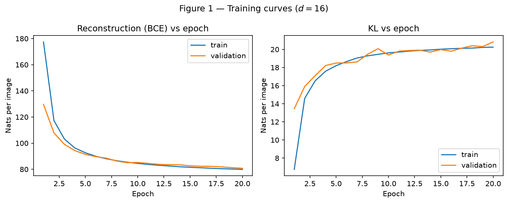
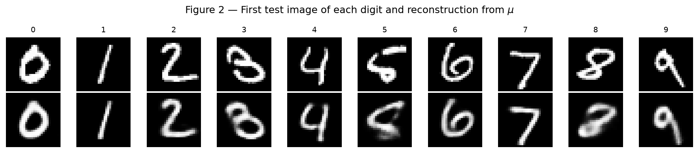
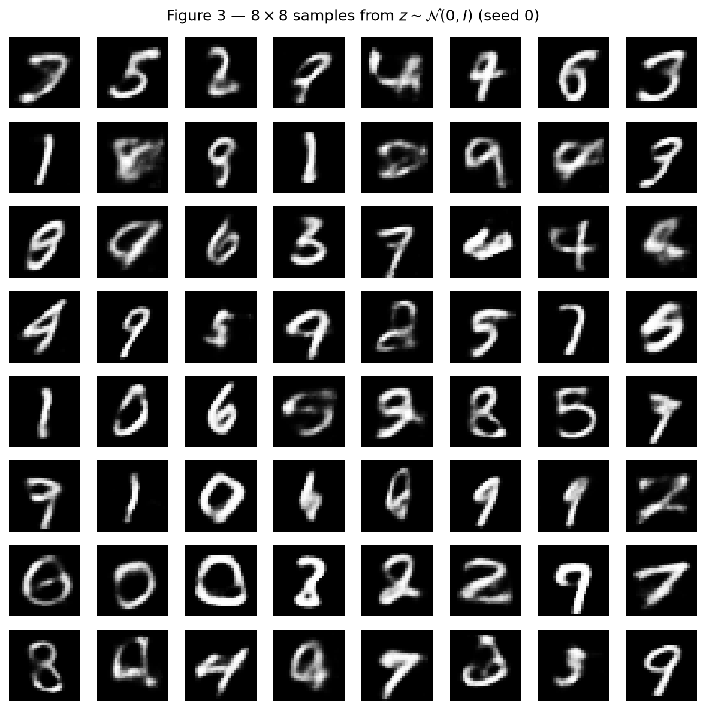
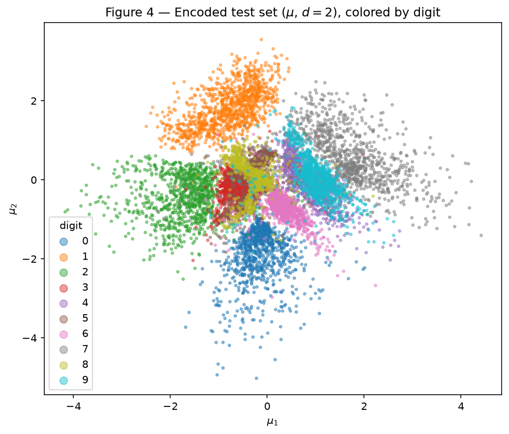
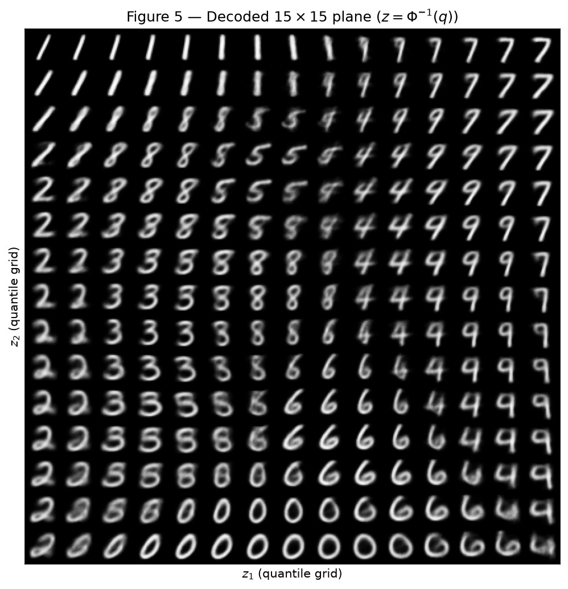
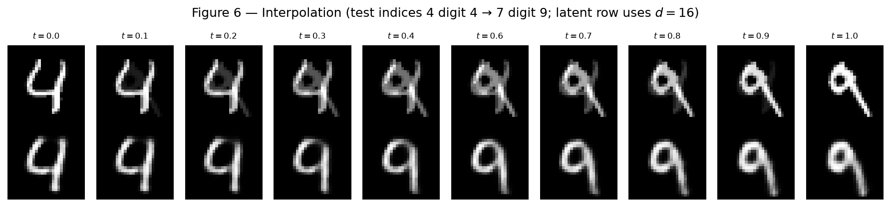

# VAE — Variational Autoencoders

**Approach.** Both exercises share one hand-written VAE in `vae.py`: encoder
$784 \to 512 \to 256$ (ReLU), heads for $\boldsymbol{\mu}$ and
$\log\boldsymbol{\sigma}^2$, decoder $d \to 256 \to 512 \to 784$ (ReLU, sigmoid),
the reparameterization $z = \mu + \sigma \odot \varepsilon$, and the loss with
BCE summed over pixels plus the closed-form KL. Exercise 1 uses $d = 16$;
Exercise 2 only changes $d$ to $2$. Seeds, split, $\beta = 1$, Adam
($10^{-3}$), batch size 128 and 20 epochs are fixed as in the statement.

Technical rules used throughout: `torch.manual_seed(42)` before each model;
the split generator `torch.Generator().manual_seed(42)`; both loss terms logged
separately in nats per image; the test set used only for the final numbers.

## Exercise 1 — A real VAE on MNIST

### A — Load and split the data

MNIST from `torchvision` with `transforms.ToTensor()` (pixels in $[0, 1]$),
flattened to 784-vectors. The 60 000 training images are split into 50 000 /
10 000 with the required generator; the 10 000 official test images are the
test set and are not touched until the final evaluation.

```python
from torch.utils.data import random_split

train_full = datasets.MNIST("data", train=True, download=True,
                            transform=transforms.ToTensor())
test = datasets.MNIST("data", train=False, download=True,
                      transform=transforms.ToTensor())
train, val = random_split(train_full, [50_000, 10_000],
                          generator=torch.Generator().manual_seed(42))
```

### B — Build the model

```python
--8<-- "docs/exercises/vae/code/vae.py"
```

The reconstruction term is
`F.binary_cross_entropy(..., reduction="sum") / batch_size`, so it is summed
over the 784 pixels and averaged over images. The KL is the closed form
$\tfrac{1}{2}\sum_i(\mu_i^2 + \sigma_i^2 - 1 - \log\sigma_i^2)$, also averaged
over the batch — no `torch.distributions.kl_divergence`.

### C — Train

Adam, learning rate $10^{-3}$, batch size 128, 20 epochs, $\beta = 1$. After
each epoch the reconstruction and KL are recorded on the training set (epoch
average) and on the validation set.

**Test numbers ($d = 16$):** reconstruction **79.98** nats/image, KL
**20.86** nats/image, negative ELBO **100.84** nats/image. That sits next to
the reference region of roughly 81 and 20. Validation KL rises from
**13.45** at epoch 1 to **20.82** at epoch 20.


/// caption
Figure 1 — Reconstruction (left) and KL (right) versus epoch, training and
validation. Reconstruction falls while the KL rises and then plateaus near 20.
///

### D — Reconstructions and samples

Figure 2 reconstructs the first test image of each digit $0$–$9$ by decoding
$\boldsymbol{\mu}$ (no sampling of $z$). Figure 3 decodes an $8 \times 8$ grid
of $z \sim \mathcal{N}(0, I)$ drawn after `torch.manual_seed(0)`.


/// caption
Figure 2 — Top: first test image of each digit. Bottom: reconstruction from
$\boldsymbol{\mu}$. Digits are recognizable; strokes are slightly soft.
///


/// caption
Figure 3 — Samples from the prior. Many look like digits; some are blurrier
or ambiguous compared with Figure 2.
///

### E — Analysis

**1. Why the KL rises while the total loss falls.** Early on, a cheap way to
keep the KL near zero is to push every $q(z \mid x)$ toward the prior and
ignore the latent code — but then reconstruction stays high. Moving
$\boldsymbol{\mu}$ and $\boldsymbol{\sigma}$ away from $(0, 1)$ costs KL, yet
it buys a larger drop in the BCE term because the decoder can finally use $z$
to explain which digit (and which style) $x$ is. Figure 1 shows that trade:
reconstruction falls by tens of nats while the KL climbs from about 13 to 21.
The optimizer pays more KL because each nat of KL buys more than one nat of
reconstruction.

**2. Why Figure 3 looks worse than Figure 2 (two reasons).**

- *Where the prior samples land.* Reconstructions in Figure 2 use
  $\boldsymbol{\mu}(x)$ for real test images, so $z$ sits where the aggregate
  encoder posterior actually puts mass. Prior samples
  $z \sim \mathcal{N}(0, I)$ can land in low-density gaps between digit
  clusters (or in the tails). The decoder has never been asked to decode those
  points from a real $x$, so the images look wrong or like no digit at all.

- *What the decoder outputs for a given $z$.* The sigmoid decoder models each
  pixel as a Bernoulli probability — the mean of $p(x \mid z)$. When several
  digit shapes are compatible with the same $z$, that mean averages them,
  which is exactly the blur discussed in the lecture. Figure 2 already shows
  some softness; prior samples amplify it because $z$ is less committed to one
  mode.

**3. Why decode $\boldsymbol{\mu}$ in Figure 2.** The goal is to show how well
the model reconstructs a given test image. Decoding $\boldsymbol{\mu}$ is the
deterministic mean of $q(z \mid x)$ and removes sampling noise. A random
$z \sim q(z \mid x)$ would add variance that has nothing to do with whether
the encoder–decoder pair is faithful, and would make the comparison across
digits unfair.

## Exercise 2 — A latent space you can see

### A — Train a 2-D VAE

Same architecture, data, seed, $\beta$ and budget as Exercise 1, with only
$d = 2$.

| | reconstruction | KL | neg. ELBO |
| --- | ---: | ---: | ---: |
| $d = 16$ (Ex. 1) | 79.98 | 20.86 | 100.84 |
| $d = 2$ (Ex. 2) | 133.86 | 6.71 | 140.58 |

The $d = 2$ numbers sit next to the reference region of roughly 135 and 7:
reconstruction is much worse, and the KL is smaller because there are only two
dimensions to push away from the prior.

### B — The encoded test set


/// caption
Figure 4 — $\boldsymbol{\mu}$ for all 10 000 test images, colored by digit.
Classes form contiguous regions with clear overlaps (e.g. 3/5/8 near the
center, 4/9 on the right).
///

### C — The decoded plane

The $15 \times 15$ grid uses $z = \Phi^{-1}(q)$ with $q$ evenly spaced in
$[0.05, 0.95]$ (`scipy.stats.norm.ppf`). That spacing gives every cell the
same prior mass under $\mathcal{N}(0, I)$, because equal steps in the CDF are
equal probability under the prior — unlike a linear grid, which over-samples
the tails.


/// caption
Figure 5 — Decoder outputs on the quantile grid. Digits change smoothly across
the plane; boundaries between classes look like morphs, not sharp cuts.
///

### D — Interpolation

Test indices **4** (digit 4) and **7** (digit 9). Top row: pixel-space blend
$(1-t)\,x_a + t\,x_b$. Bottom row: decode
$(1-t)\,\boldsymbol{\mu}_a + t\,\boldsymbol{\mu}_b$ with the $d = 16$ model
from Exercise 1.


/// caption
Figure 6 — Pixel blend (top) ghosts both digits; latent blend (bottom) passes
through images that still look like single digits.
///

### E — Analysis

**1. Which digits overlap, and what do the in-betweens look like?** In
Figure 4 the clearest overlaps are **4 with 9** (right side) and the
**3 / 5 / 8** pile near the origin; **7** also sits next to **9**. The same
transitions appear in Figure 5: moving through the 4–9 region produces
looped shapes that could be either digit, and the 3–5–8 region produces soft
S- and B-like morphs rather than a clean member of one class.

**2. What does $d = 2$ force the model to throw away?** Two numbers cannot
encode within-class style — stroke thickness, slant, openness of loops —
alongside class identity. Evidence in Figure 5: each cell shows a generic
prototype of a digit, not the variety of the test set. That missing detail is
exactly why reconstruction jumps from **79.98** ($d = 16$) to **133.86**
($d = 2$).

**3. Which row of Figure 6 looks like digits, and why?** The **latent** row.
The decoder was trained only on points that come from the encoder, so the
segment between $\boldsymbol{\mu}_a$ and $\boldsymbol{\mu}_b$ stays near the
learned manifold and decodes as a single evolving digit. The **pixel** row is
a convex combination of two unrelated 784-vectors: in the middle both ink
patterns are half-on, which is a double exposure, not a digit the model (or a
person) would write.

## Code

The model, loss and training loop are [`code/vae.py`](code/vae.py). The
notebooks that train and produce Figures 1–6 are:

- [`code/ex1_vae_mnist.ipynb`](code/ex1_vae_mnist.ipynb) (**VAE — Ex. 1 (notebook)**)
- [`code/ex2_latent_2d.ipynb`](code/ex2_latent_2d.ipynb) (**VAE — Ex. 2 (notebook)**)

`code/run_all.py` reruns both exercises end-to-end and refreshes the figures
and `metrics.json`.

## Results summary

| # | Quantity | Value |
| --- | --- | --- |
| 1 | Ex. 1 — test reconstruction, KL and negative ELBO ($d = 16$) | 79.98 / 20.86 / 100.84 |
| 2 | Ex. 1 — validation KL at the first and at the last epoch | 13.45 → 20.82 |
| 3 | Ex. 2 — test reconstruction and KL ($d = 2$) | 133.86 / 6.71 |
| 4 | Ex. 2 — the two test indices interpolated | 4 (digit 4) → 7 (digit 9) |

!!! info "AI-Use"
    AI helped scaffold the PyTorch training loop, plotting code and the report
    layout. The VAE equations (reparameterization, BCE sum, closed-form KL),
    the analysis answers, and the interpretation of the figures are my own
    understanding of the material.
